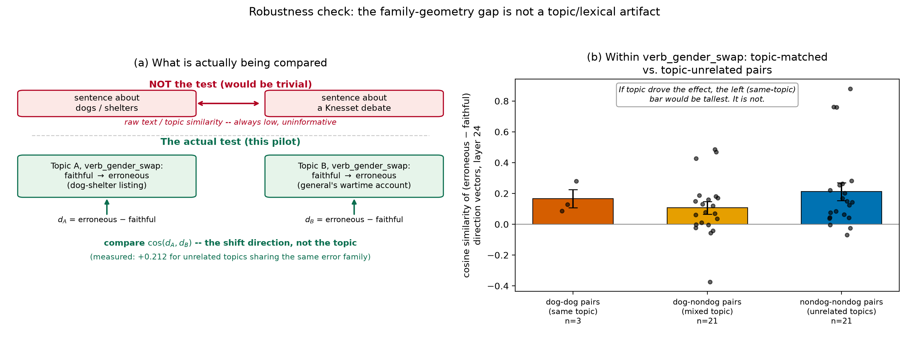

# Pilot: error-family geometry in DictaLM-3.0-1.7B-Instruct activations

Status: pilot (started 2026-11-21, expanded 2026-11-21), N=27. Not a full paper result yet — the
paper would still want cross-model replication and more N per family before this goes in as a
headline claim (see "If this becomes a real chapter" below) — but the within/between family gap is
now permutation-significant, so this is solid enough for a thesis exploratory chapter/appendix. See
the ranked research-lead writeup in the chat log of this session for how this compares to the other
two candidate leads (activation steering, DPO fine-tuning), and `../../thesis/research/
representation_geometry_pilot.md` for the thesis-facing version of this writeup.

## What this tests

Research question: do different Hebrew-morphology error *families* (noun_gender_swap,
verb_gender_swap, hebrew_root_pattern_confusion, etc. — our own taxonomy from
`summary_augmentation/utils.py`) occupy distinguishable directions in a model's hidden-state space,
or is there only one generic "something is wrong" direction? Nobody has published this for a
morphologically-rich language — see the literature survey in the chat log (closest neighbors: Marks &
Tegmark "Geometry of Truth" COLM 2024; "Do Androids Know They're Only Dreaming of Electric Sheep?"
arXiv 2312.17249, hallucination probing in abstractive summarization specifically).

## Data (`dataset.py`)

27 (faithful_sentence, erroneous_sentence) pairs, each labeled with its taxonomy `error_type` and the
model that produced it. All are confirmed real findings already verified elsewhere in this project —
no new error-finding was done here, only curation/labeling of existing findings:
- 10 pairs: full sentences, taken verbatim from `paper/figures_src/fig6_model_error_catalog.tex`
  (independently verified there).
- 3 pairs: full sentences, taken verbatim from `paper/results/eval/new50_confirmed_findings.md`
  (high-confidence confirmed findings).
- 4 pairs: the erroneous fragment is quoted verbatim from `paper/results/eval/findings_master_list_72.md`;
  the faithful counterpart was *reconstructed* (minimal gender-flip of the same fragment) because the
  full original source sentence wasn't itself quoted in that markdown. Flagged `reconstructed=True` in
  `dataset.py` — treat these 4 as weaker evidence than the other 23.
- **10 new pairs** (added in the N-expansion pass): mined from `thesisdatasets/error_finder/*.json`
  (450 raw LLM-judge rows across 15 files). That file's `correctness_error_name` field is free-text
  Hebrew and every one of the 450 rows is a unique string — it is **not** pre-mapped to this
  project's canonical taxonomy. Each of these 10 rows was manually read and hand-mapped to the
  nearest taxonomy `error_type` after a keyword-triage pass (tight matching on explicit gender/
  construct-state/root-pattern/agency terms in `correctness_error_name`, manually verified against
  the quoted text — a looser pass matched 407/450 rows and was discarded as too noisy, e.g. "בניין"
  matches both "verb pattern" and "building"). The `evidence_from_source_article`/
  `evidence_from_summary` fields in that dataset are already an aligned faithful/erroneous evidence
  pair, so these 10 needed **no reconstruction**, unlike the 4 from `findings_master_list_72.md`.

Family sizes (N=27, 7 families): verb_gender_swap=10, noun_gender_swap=7, homographic_gender_errors=3,
hebrew_root_pattern_confusion=2, verb_template_agency_reversal=2, construct_state_confusion=2,
morphological_connective_confusion=1 (the one remaining singleton, down from 4 singletons at N=17).
Still a pilot, not a fully powered study, but meaningfully less thin than the first pass.

## Method (`extract.py`, `analyze.py`, `plot.py`)

Model: `dicta-il/DictaLM-3.0-1.7B-Instruct` (Qwen3 architecture, 28 layers, hidden=2048), loaded via
`transformers` in bf16 on the local Mac (MPS backend). Chosen because it's one of the project's own
13 evaluated models (the "DictaLM 3.0-1.7B-Instruct" row in fig6) and Hebrew-native. Cross-model
replication (e.g. Qwen3-14B, Gemma3-12B) was explicitly deferred for this pass — see caveats below.

**Why this model is a justified first probe, not a sufficient one:** DictaLM-3.0-1.7B is the only
Hebrew-*native* model in the 13-model roster (the rest — GLM, Qwen3, GPT, Ministral, Nova, Gemma,
gpt-oss — are general multilingual models). That makes it the best-case candidate for this
structure to show up clearly (more capacity dedicated to Hebrew morphology than a multilingual
model), which is why it was probed first — but it also means the result could be an artifact of
Hebrew-specialized training rather than something general-purpose multilingual LLMs also do
internally. Cross-model replication is the only way to tell those apart.

**Reader-model vs. author-model:** the 27 errors were *produced* by many different models (GLM,
Qwen3-32B, GPT-3.5-Turbo, Ministral-3-14B, Nova Lite, Gemma3-12B, gpt-oss-20B,
DictaLM-2.0-Instruct — see `dataset.py`'s per-example `model` field), but every hidden state here
was extracted using only *one* fixed reader model (DictaLM-3.0-1.7B) re-processing all 27 pairs
regardless of who wrote them. So the result is scoped to "a Hebrew-native reader model represents
these error types by family internally" — not "every model that wrote an error represents it the
same way." A single fixed reader avoids a cross-model hidden-state-geometry confound, but the
generalization claim should stay scoped accordingly.

For each of the 27 pairs, both sentences were run through the model with `output_hidden_states=True`
and the **last-token hidden state at every layer** (29 = embedding + 28 transformer layers) was kept —
the standard pooling choice in this literature (Geometry of Truth, SAPLMA, INSIDE all use last-token
or similarly pooled representations rather than token-level alignment, which Hebrew subword
tokenization makes fragile anyway).

Three analyses, per layer:
1. **Binary probe**: logistic regression (sklearn, `StandardScaler` + `LogisticRegression`) predicting
   faithful(0)/erroneous(1) from the hidden state, leave-one-**pair**-out CV (both sentences of a pair
   always held out together, so no leakage). 27 folds, 54 points total, chance = 50%.
2. **Family geometry**: per example, the difference vector `d = h(erroneous) - h(faithful)`. Per layer,
   mean cosine similarity between `d` vectors of the *same* taxonomy family (within) vs *different*
   families (between), both over all 7 families and restricted to the 2 biggest families
   (verb_gender_swap, noun_gender_swap).
3. **Permutation significance test** (new in this pass): at the layer with the largest within/between
   gap, shuffle the family labels 10,000 times, recompute the gap each time, and report the fraction
   of shuffles that match or exceed the observed gap — a non-parametric p-value for "is this gap bigger
   than you'd get from random family labels."

## Results

- **Binary probe is still weak but a bit more consistent**: best layer 3 at 64.8%, mostly hovers
  50–65% without the sharp below-chance dips seen at N=17. A single generic "this sentence is wrong"
  direction is still **not** cleanly linearly decodable here from last-token pooling at this scale —
  consistent with the activation-steering literature's warning (EMNLP 2025, Klerings et al.) that
  discrete agreement-type errors behave differently from smooth hallucination/sentiment attributes.
- **Family geometry is the positive result, and it's now statistically significant**: within-family
  cosine similarity is consistently *positive* and between-family consistently *near-zero/negative* at
  nearly every layer, with the gap growing sharply from layer ~11 onward and peaking at **layer 24 of
  28** — gap = **+0.096** over all 7 families (permutation p = **0.0021**, 10,000 shuffles) and
  **+0.136** restricted to the 2 biggest families (permutation p = **0.0089**). I.e. the *direction* a
  sentence moves in activation space when a specific morphological error occurs is reliably more
  consistent within an error family than across families — not an artifact of label shuffling — and
  this structure sharpens in the later-middle layers rather than being a shallow lexical effect.
  **What is and isn't being compared here matters**: this is *not* "do two different sentences produce
  different hidden states" (trivially true, uninteresting — e.g. a sentence about a lost dog obviously
  differs from a sentence about a Knesset debate). It's whether the *shift vector*
  `d = h(erroneous) - h(faithful)` points in a similar direction for two sentences that share nothing
  but the error mechanism, even when their topics are completely unrelated. That could easily have come
  back negative (and the binary probe above, a much simpler test, mostly did) — it didn't.
- See `repr_pilot_figure.png`: (a) binary-probe accuracy curve, (b) within/between family-geometry gap
  curve with the permutation p-values annotated, (c) PCA of the layer-24 difference vectors colored by
  taxonomy family.

## Robustness check: is this just a topic/lexical confound? (`confound_check.py`)

A fair objection to the family-geometry result: 4 of the 10 `verb_gender_swap` examples are
near-identical text genre (lost-dog / shelter-adoption listings — `dicta2.0_uzi`,
`qwen14b_juan_finder`, `qwen14b_chupi_finder`, `qwen14b_hason_finder`). If those four cluster
together because they're topically similar boilerplate rather than because they share a
gender-swap *mechanism*, the headline result would be a topic artifact, not a real finding.

Checked this directly at layer 24:
- **Dog-dog pairs** (within verb_gender_swap): mean cosine similarity **+0.165**.
- **Non-dog/non-dog pairs** (within verb_gender_swap, completely unrelated topics — a general's
  wartime account, a Knesset floor debate, a book-jacket caption): mean **+0.212** — *higher* than
  the dog-dog pairs, not lower. If topic overlap were driving the effect, dog-dog should be the
  highest of the three; it isn't.
- Recomputing the full within/between gap with 3 of the 4 dog examples **dropped** (N=24, keeping
  only 1 dog example as in the original N=17 set): gap = **+0.083** (vs. +0.096 on the full N=27),
  permutation p = **0.0120** — same sign, same order of magnitude, still significant. The result
  does not depend on that cluster.

Conclusion: the within-family signal tracks the grammatical error mechanism, not surface topic or
lexical overlap between same-genre articles.

See `confound_plot.py` for the figure source (`fig_confound_robustness.png`).

## Honest caveats

- N=27 is a larger pilot than the original N=17, but still a pilot — 1 of the 7 families
  (morphological_connective_confusion) remains a singleton, and 2 more (hebrew_root_pattern_confusion,
  verb_template_agency_reversal, construct_state_confusion) sit at n=2. The permutation test confirms
  the *overall* gap is unlikely to be chance, but per-family separability for the n=1/n=2 families
  individually is still not well-powered.
- Single model (DictaLM-3.0-1.7B), single run — cross-model replication (Qwen3-14B, Gemma3-12B, both
  already in the project's evaluated roster) was explicitly deferred for this pass. The claim here is
  scoped to this model only.
- 4 of the 27 pairs (the `findings_master_list_72.md`-sourced ones) use a reconstructed, not
  source-verified, faithful counterpart; the 10 new `error_finder`-sourced pairs do not have this
  weakness (their faithful/erroneous text is directly quoted, aligned evidence).

## If this becomes a real chapter

Remaining next steps, roughly in order of cost: (1) expand N further, especially for the thin
families (construct_state_confusion, hebrew_root_pattern_confusion, verb_template_agency_reversal,
morphological_connective_confusion) by continuing the `error_finder` triage pass with looser
per-family keyword sets and manual review; (2) repeat the extraction on 1-2 more open-weight models
already in the evaluated roster (Qwen3-14B, Gemma3-12B) to test whether the layer-24-ish
family-geometry structure is DictaLM-specific or general; (3) as a cheap follow-on, test whether the
layer-24 per-family mean difference vector is *causally* steerable (add it back into generation and
see if it shifts the model toward/away from that error family) — this reuses these exact vectors and
would be the activation-steering lead's pilot, done almost for free.
