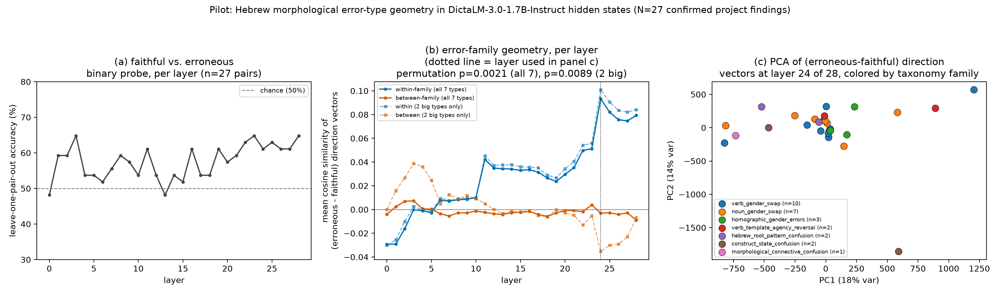

# Pilot: error-family geometry in hidden-state activations

Status: **pilot result, not yet a fully powered study** (first run 2026-11-21 at N=17, expanded
same day to N=27). Intended as the basis for an exploratory/discussion chapter or appendix in the
thesis — theses have room for "here's a genuine open question, here's suggestive evidence that's
now permutation-significant, here's how to properly power the follow-up" in a way the ACL-format
paper doesn't (the paper would still want cross-model replication before this becomes a headline
claim there). See `../../docs/research_leads/representation_geometry_pilot/` for the full code,
raw data, and the source-of-truth version of this writeup; this file is the thesis-facing copy.

## Research question

MorphEvalHeb's taxonomy (`summary_augmentation/utils.py`) groups the morphological/grammatical
errors LLMs produce when summarizing Hebrew news articles into named families — noun_gender_swap,
verb_gender_swap, homographic_gender_errors, hebrew_root_pattern_confusion, and others. The
taxonomy is useful for human analysis, but it raises a representation-learning question nobody
has published an answer to: **do these error families correspond to distinguishable directions
inside a model's hidden-state space**, or is "the summary contains a morphological error" just one
generic direction with the taxonomy being a human-imposed label on top of otherwise
indistinguishable activations?

If error families *are* geometrically distinguishable, that's evidence the taxonomy tracks a real
structural property of how these models represent Hebrew morphology internally — not just a
post-hoc descriptive scheme — and it opens a cheap follow-on: if a family has a consistent
direction, it may also be *causally steerable* (Section "Next steps" below).

### Why this is a gap worth filling

Binary hallucination/truthfulness probing of hidden states is well established: Marks & Tegmark's
"Geometry of Truth" (COLM 2024, arXiv 2310.06824) finds linear truth directions and mass-mean
probes; SAPLMA (arXiv 2304.13734) and INSIDE (arXiv 2402.03744) train hidden-state classifiers for
hallucination detection; arXiv 2312.17249 ("Do Androids Know They're Only Dreaming of Electric
Sheep?") probes hallucination specifically in abstractive summarization and finds it peaks by
layer 4. None of this literature asks whether *different error types* occupy *different*
directions — they all collapse to a single faithful/unfaithful axis. For a morphologically rich
language like Hebrew, where errors are categorical (gender agreement, root-pattern confusion,
construct-state confusion) rather than a single smooth "truthiness" dimension, that collapse may
be the wrong model — this pilot tests whether it is.

## Data

27 (faithful, erroneous) sentence pairs, each labeled with its taxonomy `error_type` and the model
that produced the error. All are drawn from findings already confirmed elsewhere in the project —
no new error-finding was done for this pilot, only curation and taxonomy labeling of existing
findings:

- **10 pairs**: full sentences, taken verbatim from `../../paper/figures_src/fig6_model_error_catalog.tex`.
- **3 pairs**: full sentences, taken verbatim from `../../paper/results/eval/new50_confirmed_findings.md`.
- **4 pairs**: the erroneous fragment is quoted verbatim from
  `../../paper/results/eval/findings_master_list_72.md`; the faithful counterpart was
  *reconstructed* (minimal gender-flip of the same fragment) because the full original source
  sentence wasn't itself quoted there. Flagged `reconstructed=True` in the dataset — weaker
  evidence than the other 23 pairs.
- **10 pairs**: mined from `../../thesisdatasets/error_finder/*.json` (450 raw LLM-judge rows
  across 15 files, one per model/batch run). That file's `correctness_error_name` field is
  free-text Hebrew — every single one of the 450 rows is a *unique* string, i.e. not pre-mapped to
  this project's canonical taxonomy. Each of the 10 rows used here was manually read and hand-
  mapped to the nearest taxonomy `error_type` after a keyword-triage pass: a first, loose keyword
  match hit 407 of 450 rows (useless — e.g. the word "בניין" matches both "verb pattern" and
  "building" in Hebrew) and was discarded; a tight pass requiring explicit gender/construct-state/
  root-pattern/agency terms in `correctness_error_name`, manually verified against the quoted
  evidence text, produced the 10 pairs used. Their `evidence_from_source_article`/
  `evidence_from_summary` fields are already an aligned faithful/erroneous evidence pair, so these
  10 needed **no reconstruction** — a methodological improvement over the 4
  `findings_master_list_72.md` pairs above.

Family sizes (N=27, 7 families): verb_gender_swap=10, noun_gender_swap=7,
homographic_gender_errors=3, hebrew_root_pattern_confusion=2, verb_template_agency_reversal=2,
construct_state_confusion=2, morphological_connective_confusion=1 (the one remaining singleton,
down from 4 singletons at the original N=17). Meaningfully less thin than the first pass, but still
a pilot rather than a fully powered study — see caveats below.

## Method

Model: `dicta-il/DictaLM-3.0-1.7B-Instruct` — one of the project's own 13 evaluated models (the
"DictaLM 3.0-1.7B-Instruct" row in Figure 6), Hebrew-native, run locally in bf16 via
`transformers` (MPS backend on an M5 Pro Mac). Cross-model replication (e.g. Qwen3-14B,
Gemma3-12B, both already in the project's evaluated roster) was explicitly deferred for this pass
— the result below is scoped to this one model.

**Why this model, and what that does and doesn't justify.** DictaLM-3.0-1.7B is the only
Hebrew-*native* model in the project's 13-model roster — the rest (GLM, Qwen3, GPT, Ministral,
Nova, Gemma, gpt-oss) are general multilingual models splitting capacity across many languages. It
was picked for two practical reasons (small enough to run fast locally; already in the evaluated
roster) and one substantive one: a Hebrew-specialized model is the *best-case* candidate for
showing this structure clearly, since it has more capacity dedicated to Hebrew morphology than a
multilingual model would. That is a reasonable justification for probing this model *first*, but
it is not a justification for treating this model as *sufficient* — the result could just as
easily be an artifact of Hebrew-specialized training rather than something general-purpose
multilingual LLMs also do internally. Only testing another model (ideally one of the multilingual
ones already in the roster) can distinguish those two possibilities.

**Reader-model vs. author-model — a scoping point worth stating explicitly.** The 27 errors in the
dataset were *produced* by many different models (GLM-4.7-Flash, Qwen3-32B, GPT-3.5-Turbo,
Ministral-3-14B, Amazon Nova Lite, Gemma3-12B, gpt-oss-20B, DictaLM-2.0-Instruct — see `dataset.py`
for the per-example `model` field), but every hidden state in this pilot was extracted using only
*one* reader model, DictaLM-3.0-1.7B-Instruct, re-processing all 27 sentence pairs regardless of
which model originally wrote them. So the claim this pilot supports is narrower than it might first
sound: **"when a Hebrew-native reader model processes these sentences, the error types it
represents internally cluster by taxonomy family"** — not "every model that produced these errors
represents its own error the same way internally." Using a single fixed reader model is actually a
clean design choice (it removes any confound from different models' hidden-state geometries being
incomparable to each other), but it means the generalization claim should stay scoped to "a
Hebrew-specialized reader model," not "LLMs in general" or even "the models that wrote these
errors."

For each of the 27 pairs, both sentences were run through the model with
`output_hidden_states=True`, and the **last-token hidden state at every layer** (29 = embedding +
28 transformer layers) was kept — the standard pooling choice in this literature (Geometry of
Truth, SAPLMA, INSIDE all use last-token or similarly pooled representations rather than
token-level alignment, which Hebrew subword tokenization makes fragile anyway).

Three analyses, computed per layer:

1. **Binary probe**: logistic regression (`StandardScaler` + `LogisticRegression`) predicting
   faithful(0) vs. erroneous(1) from the hidden state, leave-one-**pair**-out cross-validation
   (both sentences of a pair always held out together, to prevent leakage). 27 folds, 54 points
   total, chance = 50%.
2. **Family geometry**: per example, the difference vector `d = h(erroneous) − h(faithful)`,
   L2-normalized. Per layer, mean cosine similarity between `d` vectors of the *same* taxonomy
   family (within) vs. *different* families (between) — computed both over all 7 families and
   restricted to the 2 biggest families.
3. **Permutation significance test** (added in this expansion pass): at the layer with the largest
   within/between gap, shuffle the family labels 10,000 times, recompute the gap each time, and
   report the fraction of shuffles that match or exceed the observed gap — a non-parametric
   p-value testing whether the gap is bigger than chance family-label assignment would produce.

## Results

*Figure: (a) leave-one-pair-out binary faithful-vs-erroneous probe accuracy, per layer, N=27 pairs.
(b) mean cosine similarity of (erroneous − faithful) direction vectors, within- vs. between-family,
per layer, with the permutation-test p-values at the best layer annotated in the title (dashed
lines restrict to the two biggest families). (c) PCA (2 components) of the difference vectors at
layer 24 — the layer with the largest within/between gap — colored by taxonomy family.*

- **Binary probe is still weak, but a bit more stable with more data.** Best layer is layer 3 at
  64.8% (panel a); accuracy mostly sits in the 50–65% range without the sharp below-chance dips
  seen in the original N=17 run. A single generic "this sentence is wrong" direction is still
  **not** cleanly linearly decodable here from last-token pooling at this scale. This is an honest
  negative result, and it lines up with a specific warning from the activation-steering
  literature: Klerings et al. (EMNLP 2025, arXiv 2509.12065) found discrete, categorical
  grammatical features (verb tense/aspect) are harder to steer than smooth attributes, and chose
  English specifically to avoid morphological complexity. A Hebrew gender-agreement error
  plausibly behaves the same way — not one smooth "wrongness" axis.
- **Family geometry is the positive result, and it is now statistically significant.** Within-
  family cosine similarity is consistently *positive* and between-family consistently *near-zero
  or negative* at nearly every layer (panel b), with the gap growing sharply from layer ~11 onward
  and peaking at **layer 24 of 28**: gap = **+0.096** over all 7 families (permutation p =
  **0.0021**, 10,000 label-shuffles) and **+0.136** restricted to the 2 biggest families
  (verb_gender_swap, noun_gender_swap; permutation p = **0.0089**). In other words: the *direction*
  a sentence moves in activation space when a specific morphological error occurs is reliably more
  consistent within an error family than across families — and this is now a result that survives
  a non-parametric significance test, not just an eyeballed curve — and this structure sharpens in
  the later-middle layers rather than being a shallow lexical effect.

  **What this is, and specifically what it is not, comparing.** It would be easy to misread this as
  "of course two different sentences produce different hidden states" — trivially true, and
  uninteresting (a sentence about a lost dog obviously differs from a sentence about a Knesset
  debate; comparing their raw representations tells you nothing). That is explicitly *not* what is
  measured here. The comparison is between *shift vectors* — `d = h(erroneous) - h(faithful)`,
  the direction a sentence moves when its faithful version is turned into its erroneous version —
  for pairs of examples that may come from completely unrelated topics, articles, and source
  models, and asks whether that direction is more similar when the two examples share an error
  *mechanism* (e.g. both are verb_gender_swap) than when they don't. That is a real empirical
  question that could have come back negative — and the simpler binary probe above, which asks a
  related but easier question, mostly did. See Figure (below, panel a) for a schematic of this
  distinction, and the robustness check right after for the concrete numbers that back it up.
- **PCA at layer 24** (panel c) shows the verb_gender_swap and noun_gender_swap clusters (the two
  biggest families) occupying visually distinguishable regions, with the thinner families
  scattered more diffusely — consistent with a real geometric structure that is still noisier for
  the less-populated families.

## Robustness check: is this just a topic/lexical confound?

A fair objection to the family-geometry result above: 4 of the 10 `verb_gender_swap` examples are
near-identical text genre — lost-dog / shelter-adoption listings
(`dicta2.0_uzi`, `qwen14b_juan_finder`, `qwen14b_chupi_finder`, `qwen14b_hason_finder`). If those
four cluster together simply because they're topically similar boilerplate (short texts, shared
vocabulary like "כלב/כלבה", "מחפש/ת בית/אהבה"), rather than because they share a gender-swap
*mechanism*, the whole result would be a topic artifact dressed up as a representation-learning
finding — which is exactly the "obvious, not interesting" version of this claim.

Checked this directly at layer 24 (full script: `../../docs/research_leads/
representation_geometry_pilot/confound_check.py`):

- **Dog-dog pairs** (within verb_gender_swap): mean cosine similarity **+0.165**.
- **Non-dog/non-dog pairs** (within verb_gender_swap, completely unrelated topics — a general's
  wartime account, a Knesset floor debate, a book-jacket caption): mean **+0.212** — *higher* than
  the dog-dog pairs. If topic overlap were driving the clustering, dog-dog pairs should be the most
  similar of the three; instead, examples sharing nothing but the grammatical error mechanism are
  at least as similar to each other.
- Dropping 3 of the 4 dog examples entirely (N=24, keeping only one dog example, matching the
  original N=17 dataset) and recomputing the full within/between gap: **+0.083** (vs. +0.096 on
  the full N=27 set) — same sign, same order of magnitude, and still permutation-significant
  (p = **0.0120**, 10,000 shuffles).

This is the key check that separates the claim from the trivial version of it ("different
sentences produce different activations," which is always true and uninteresting). The signal
tracks the grammatical error mechanism, not surface topic or lexical overlap between same-genre
source articles.

Figure source: `../../docs/research_leads/representation_geometry_pilot/confound_plot.py`.

## Honest caveats

- N=27 is a larger pilot than the original N=17, but still not a fully powered study. 1 of the 7
  families (morphological_connective_confusion) remains a singleton, and 3 more
  (hebrew_root_pattern_confusion, verb_template_agency_reversal, construct_state_confusion) sit at
  n=2. The permutation test confirms the *overall* gap is unlikely to be chance, but per-family
  separability for the thinnest families individually is still not well-powered.
- Single model (DictaLM-3.0-1.7B-Instruct), single run. Cross-model replication (Qwen3-14B,
  Gemma3-12B, both already in the project's evaluated roster) was **explicitly deferred** for this
  pass — the claim here is scoped to DictaLM-3.0-1.7B-Instruct only.
- 4 of the 27 pairs (from `findings_master_list_72.md`) use a reconstructed, not source-verified,
  faithful counterpart. The 10 pairs newly added from `error_finder` do not have this weakness —
  their faithful/erroneous text is directly quoted, already-aligned evidence.

## Next steps, if this becomes a full chapter

Remaining steps, roughly in cost order:

1. **Expand N further for the thin families** (construct_state_confusion,
   hebrew_root_pattern_confusion, verb_template_agency_reversal, morphological_connective_confusion)
   by continuing the `../../thesisdatasets/error_finder/*.json` triage with looser, family-specific
   keyword sets and manual review of the remaining ~400 unclassified rows.
2. **Causal follow-on (near-free given this pilot's output):** test whether the layer-24 per-family
   mean difference vector is *causally* steerable — add it back into generation and see if it
   shifts the model toward/away from that error family. This would double as the pilot for the
   activation-steering research lead, reusing these exact vectors.
3. *(Lower priority, explicitly deferred per project discussion)* repeat the extraction on 1–2
   more open-weight models already in the evaluated roster (Qwen3-14B, Gemma3-12B), to test
   whether the layer-24-ish family-geometry structure is DictaLM-specific or general.

## Code and raw data

Full reproducible pipeline (dataset construction, extraction, analysis, plotting) and raw
artifacts (`hidden_states.npz`, `records.json`, `analysis_results.npz`) live at
`../../docs/research_leads/representation_geometry_pilot/`, not duplicated here — this file is the
thesis-facing writeup; that folder is the source of truth for the experiment itself.
